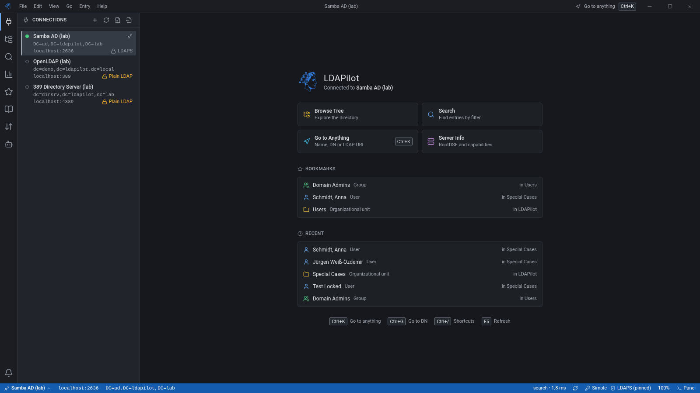
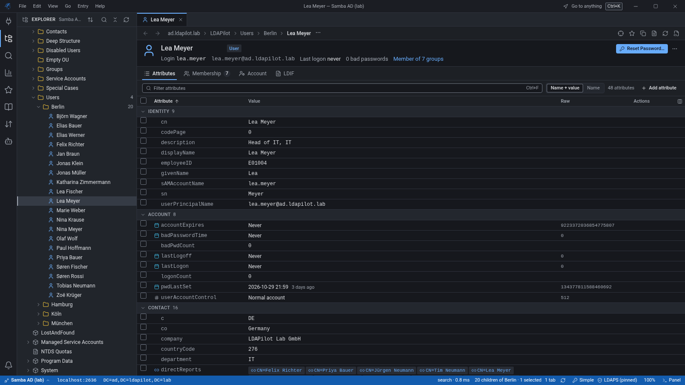
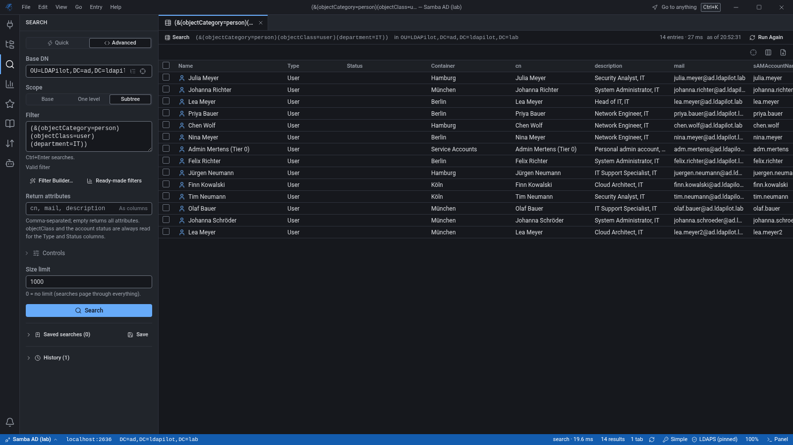
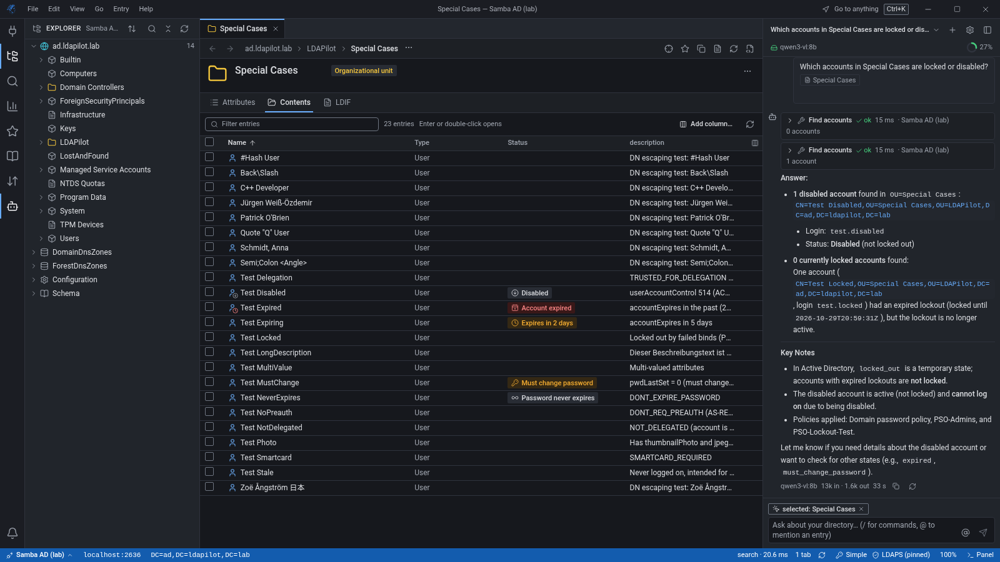
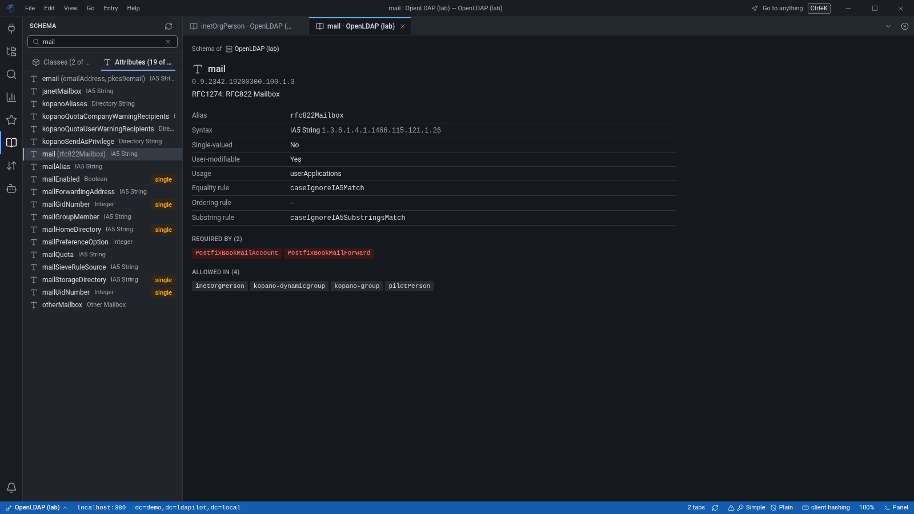
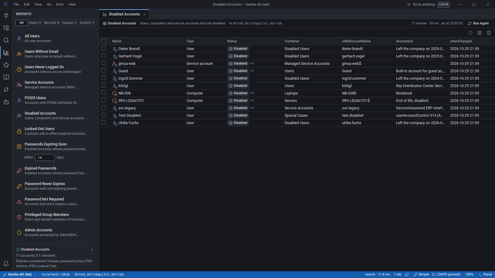
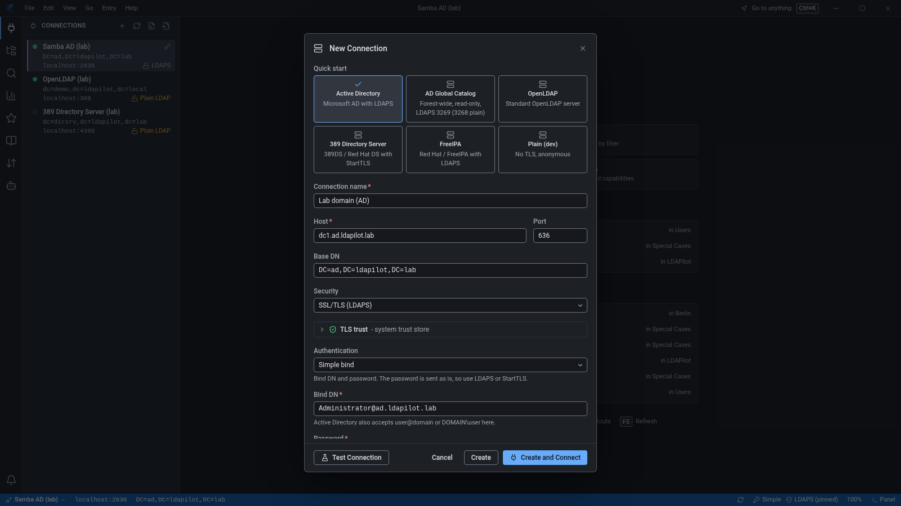

<h1 align="center">🧭 LDAPilot</h1>

<h4 align="center">A modern, fast and cross-platform <strong>LDAP browser</strong> and directory administration tool for Active Directory, OpenLDAP and 389 Directory Server.</h4>

<p align="center">
  <a href="https://github.com/DPicillo/LDAPilot/actions/workflows/ci.yml"></a>
  <a href="https://github.com/DPicillo/LDAPilot/releases/latest"></a>
</p>

<p align="center">
  <a href="#key-features">Key Features</a> •
  <a href="#screenshots">Screenshots</a> •
  <a href="#installation">Installation</a> •
  <a href="#test-lab">Test Lab</a> •
  <a href="#development">Development</a> •
  <a href="CHANGELOG.md">Changelog</a>
</p>

---

## 🚀 Overview

**LDAPilot** is an **LDAP browser** and **Active Directory management tool** for system administrators, identity and access management engineers and developers who need a reliable, modern interface to their directory services.

It works with **Active Directory** (incl. Samba AD), **OpenLDAP**, **389 Directory Server / Red Hat Directory Server**, **FreeIPA** and any other LDAP v3 server — from simple browsing to account administration, bulk changes and an AI assistant that only writes after you approve.

LDAPilot is an open-source alternative to classic LDAP clients such as Apache Directory Studio, LDAP Admin or Softerra LDAP Browser: a native desktop app (Go + React, no Electron) with a light and a dark theme, a command palette, full keyboard control and cross-platform support.

**Current version: 0.5.0** — see the [changelog](CHANGELOG.md).

<p align="center">
  
</p>

## 📸 Screenshots

<table>
  <tr>
    <td align="center"><strong>🌳 Directory Browser</strong></td>
    <td align="center"><strong>🔍 Advanced Search</strong></td>
  </tr>
  <tr>
    <td></td>
    <td></td>
  </tr>
  <tr>
    <td align="center"><strong>🤖 AI Chat Assistant</strong></td>
    <td align="center"><strong>📖 Schema Browser</strong></td>
  </tr>
  <tr>
    <td></td>
    <td></td>
  </tr>
  <tr>
    <td align="center"><strong>📊 Reports</strong></td>
    <td align="center"><strong>🔗 New Connection</strong></td>
  </tr>
  <tr>
    <td></td>
    <td></td>
  </tr>
</table>

## ✨ Key Features

### 🔐 Connections & Authentication
- **Bind methods** — simple bind, **NTLM**, **Kerberos / GSSAPI** (password or credential cache; the logged-on user via SSPI on Windows) and **SASL EXTERNAL** with a client certificate
- **TLS trust per connection** — LDAPS and StartTLS, custom **CA certificates** (also taken from the server), client certificates (mTLS) and **certificate pinning** by SHA-256 fingerprint; an unknown or changed certificate opens a trust prompt that shows the chain and the old and new fingerprints
- **Presets** for Active Directory, AD Global Catalog, OpenLDAP, 389 Directory Server and FreeIPA; **Test Connection** reports the server type, vendor, TLS version, identity and naming contexts ("Use as base DN")
- **Read-only profiles** enforced in the backend, a password prompt when no password is stored (or, per profile, on every connect), clear bind error hints (AD sub-codes such as 52e, 775), automatic reconnect with a visible "connection lost" state
- **Several directories at once** — every tab, search result and log belongs to its connection; switch from the status bar or the palette
- **Encrypted storage** (AES-256-GCM) for passwords and API keys; import / export of selected profiles without secrets, several profiles deleted at once; referral following that only sends credentials to trusted servers

### 🌳 Browsing
- **Virtualized tree** for large directories; containers with more than 500 children open as a list
- **All naming contexts as roots** — AD domains of the forest, DomainDnsZones / ForestDnsZones, **Configuration** and **Schema**; naming contexts on OpenLDAP and 389DS
- **Preview tabs**, Back / Forward, an editable breadcrumb, a **Contents** list per container, bookmarks and recent entries
- **Find in Tree**, Show in Tree from anywhere, drag and drop moves with confirmation, multi-select with batch actions, object statistics per container (can be stopped)
- **Undo** for moves and bookmark changes from the toast, the notification bell or `Ctrl+Z` (10 minutes)
- **Bookmarks** follow renamed and moved entries by their permanent id (objectGUID / entryUUID / nsUniqueId) and can be renamed and reordered

### ✏️ Entries & Attributes
- **Attribute table** with schema tooltips, inline editing, MUST / MAY suggestions, SINGLE-VALUE checks and server-maintained attributes protected
- **New Entry templates** per server type (AD user / group / computer / contact, LDAP and POSIX users and groups, OUs, custom classes), **Copy Entry** that never copies passwords or login identities, Rename, Move with a container picker, Compare
- **Binary values** — photos (`thumbnailPhoto`, `jpegPhoto`) with preview and upload, **X.509 certificates** and **PKCS #7** (`userSMIMECertificate`) decoded, hex dump for everything else, save and upload from file; objectGUID / objectSid shown readably
- **LDIF view** of every entry (RFC 2849, re-importable) and **Edit as LDIF**: edit the entry as text, review the computed changes in a dry run (incl. rename / move from the `dn:` line), apply them as one atomic modify
- **Certificates** show key usage, extended key usage, alternative names and an expiry warning; entries with several photos or certificates ask which one

### 🔑 Passwords
- **Per-connection password storage policy** (GitHub issue #1): every write path that touches `userPassword` follows it — automatic (OpenLDAP: client-side `{CRYPT}` SHA-512-crypt; 389DS: the server hashes; AD: `unicodePwd`), a fixed client-side scheme, server-side hashing, or ask each time
- **Hashing schemes** — `{SSHA}`, `{SSHA256}`, `{SSHA512}`, `{PBKDF2-SHA256/512}`, `{ARGON2}`, `{CRYPT}` SHA-256 / SHA-512-crypt and bcrypt (weak legacy schemes are marked); already hashed values and pass-through references such as `{SASL}user` (saslauthd) are recognised and stored unchanged
- **RFC 3062 Password Modify** extended operation, AD `unicodePwd` resets with "must change at next logon" and unlock in the same request
- The stored scheme is **read back after every write**: cleartext values or hashes the server cannot verify are reported with a fix (Remove Value / Reset Password…); cleartext passwords over an unencrypted connection need an explicit confirmation (never for `unicodePwd`)
- **Reset Password dialog** with generator, strength meter that knows the account names and the password policy, and the account options (must change, unlock, enable)

### 👤 Account Status & Actions
- **One account status** for AD (userAccountControl, computed lockout, fine-grained password policies), OpenLDAP **ppolicy** and **389DS** (nsAccountLock, roles, lockout and password policies)
- **Unlock, enable / disable, must change password, password never expires, account expiry** and a userAccountControl flag editor that warns when a change weakens the account
- Status chips in the tree, results, Contents lists and tabs; an **Account** tab per entry
- **Reports** — locked-out users, disabled accounts, expiring and expired passwords, never logged on, users without e-mail, password never expires / not required, admin accounts, **privileged group members** (nested), empty groups, POSIX users and groups, computers; results open in their own tab and export to CSV

### 👥 Group Membership
- **Effective (nested) membership** in both directions with depth, paths ("via"), **cycle detection** and the AD primary group; AD uses the in-chain matching rule, other servers are resolved level by level
- Add / remove members one value at a time (never rewriting the member list), **Add to Group…** for one or many entries, confirmation for changes that would close a cycle

### 🗑️ Deleted Objects & Recursive Delete
- **AD Deleted Objects** view: restore (reanimation) or restore to another container, parents before children, with the list of attributes and memberships a tombstone lost
- **Recursive delete** with descendant count — the tree delete control when the server has it, otherwise client-side with progress, stop and continue-on-error; naming contexts and large deletes need a typed confirmation

### 📦 Bulk Changes & LDIF
- **Bulk modify** from search results or a tree selection with value templates (`%givenName% (%sn:lower%)`), a **dry run** table (before → after per entry), apply with progress, stop and "retry failed"
- **LDIF change files** (RFC 2849: add, modify, modrdn, delete) with the same dry run — incl. AD uniqueness checks for `sAMAccountName` / `userPrincipalName` — rebasing into another container, and a run report
- **Export** of an entry, a list of entries, one level or a subtree as importable LDIF or as CSV

### 🔍 Search
- **Quick search** by name and object type (users, contacts, groups, computers, OUs — per server family) and **advanced search** with scope, return attributes and a live-validated filter
- **Filter builder** that round-trips with the filter text (incl. "does not exist" and AD bit-flag operators), RFC 4515 escaping everywhere
- AD controls (Show Deleted, Show Recycled) and ManageDsaIT only when the server supports them; paged results, size limits and "Load all"
- History and saved searches per connection, result columns per connection, CSV / TSV / LDIF export of the visible table
- **Results as tabs** — keep a search or report result as its own tab (re-run, export, bulk actions) next to the live results

### 📖 Schema, Server Info & Logs
- **Schema browser** for object classes and attributes (inherited MUST / MAY, syntax, RFC 4512 definitions, aliases such as `rfc822Mailbox` → `mail`)
- **Server Info** with the full RootDSE (controls, extensions, naming contexts, vendor)
- **Operations log** per connection and a persistent **audit log** of every write (old → new values, secrets masked, Show History of an entry across renames)

### 🎨 Design & Keyboard
- New design with a **light and a dark theme** (or follow the system), compact density, zoom 80–150 %
- **Command palette** (`Ctrl+K`): find entries by name, run any command, go to a DN or LDAP URL (`Ctrl+G`)
- **Full keyboard control** — every menu command and shortcut comes from one registry; `Ctrl+/` lists them all
- Every write asks before data is lost: unsaved edits are kept per tab and guarded on close and quit

### 🤖 AI Assistant
- **Chat about your directories** — "Why can't this user log in?", "Which groups is deep.user in?", "Compare the users of both servers"; the assistant searches, counts, reads entries, resolves memberships and account states on every connected directory
- **Providers** — any OpenAI-compatible API (OpenAI, LiteLLM, vLLM, LM Studio, Ollama `/v1`), native **Ollama**, **Anthropic**, and the **Claude Code headless engine** (`claude -p` with a private, per-run MCP server; on Windows also a Claude Code installed only in WSL)
- **Model auto-detection** from the provider (context window and tool support included); local models stay on your machine
- **Approvals** — per-connection access (none / ask / read / write); every change is shown as an exact diff with decoded values and needs your approval; read-only profiles always refuse; writes are audited "via AI"
- **Privacy** — secret attributes are never read, a redaction list for your own attributes, passwords typed into the chat are never sent, generated passwords are shown only to you; chats are stored encrypted
- **Ask AI about …** any entry from its menu; the chat can be docked to the side bar or to the right of the editor

## 💻 Installation

### Windows

Download and run **[LDAPilot-windows-amd64-installer.exe](https://github.com/DPicillo/LDAPilot/releases/latest/download/LDAPilot-windows-amd64-installer.exe)**. The setup asks whether to install for you only (no admin rights needed) or for all users, and adds the WebView2 runtime if it is missing.

Or install it for your user straight from PowerShell:

```powershell
curl.exe -fLo "$env:TEMP\LDAPilot-setup.exe" https://github.com/DPicillo/LDAPilot/releases/latest/download/LDAPilot-windows-amd64-installer.exe; & "$env:TEMP\LDAPilot-setup.exe" /SILENT /CURRENTUSER
```

Prefer not to install anything? [LDAPilot-windows-amd64.exe](https://github.com/DPicillo/LDAPilot/releases/latest/download/LDAPilot-windows-amd64.exe) is the portable build: download it and run it.

### Linux

```sh
# Debian 12+, Ubuntu 22.04+
curl -fLo /tmp/ldapilot.deb https://github.com/DPicillo/LDAPilot/releases/latest/download/LDAPilot-linux-amd64.deb && sudo apt install /tmp/ldapilot.deb

# Fedora, RHEL / Rocky / Alma 10 (on Rocky and Alma run "sudo dnf install epel-release" first)
sudo dnf install https://github.com/DPicillo/LDAPilot/releases/latest/download/LDAPilot-linux-amd64.rpm

# RHEL / Rocky / Alma 9
sudo dnf install https://github.com/DPicillo/LDAPilot/releases/latest/download/LDAPilot-linux-amd64.el9.rpm

# openSUSE (the package is not signed yet)
sudo zypper install --allow-unsigned-rpm https://github.com/DPicillo/LDAPilot/releases/latest/download/LDAPilot-linux-amd64.rpm
```

Without root, just for you, on any distribution with WebKitGTK (installs into `~/.local`):

```sh
curl -fL https://github.com/DPicillo/LDAPilot/releases/latest/download/LDAPilot-linux-amd64.tar.gz | tar -xz -C /tmp && /tmp/LDAPilot-linux-amd64/install.sh
```

LDAPilot then appears in your application menu. To update, run the same command again.

### macOS

Download **[LDAPilot-macos-universal.zip](https://github.com/DPicillo/LDAPilot/releases/latest/download/LDAPilot-macos-universal.zip)** (Apple silicon and Intel), unzip it and move `LDAPilot.app` to Applications. Or in Terminal:

```sh
curl -fLo /tmp/LDAPilot.zip https://github.com/DPicillo/LDAPilot/releases/latest/download/LDAPilot-macos-universal.zip && ditto -xk /tmp/LDAPilot.zip /Applications && open /Applications/LDAPilot.app
```

The app is not notarized yet. If macOS refuses to open it, allow it once under System Settings › Privacy & Security › Open Anyway.

### All downloads, software distribution

Every file and its checksum (`SHA256SUMS.txt`) is on the [releases page](https://github.com/DPicillo/LDAPilot/releases). The builds are not code-signed yet, so Windows SmartScreen may ask once when you start a downloaded file ("More info" → "Run anyway").

Rolling LDAPilot out with Intune, Configuration Manager or Ivanti DSM? Silent install commands, exit codes and detection rules are in [docs/installation.md](docs/installation.md).

### Build from Source

#### Prerequisites
- [Go 1.26+](https://go.dev/dl/)
- [Node.js 22.12+](https://nodejs.org/en/download/) (or 20.19+; the frontend tests need 22.18+)
- [Wails CLI v2](https://wails.io/docs/gettingstarted/installation) matching `go.mod`: `go install github.com/wailsapp/wails/v2/cmd/wails@v2.17.0`
- Linux: GTK 3 and WebKit2GTK, e.g. on Debian 13+ `sudo apt install libgtk-3-dev libwebkit2gtk-4.1-dev`

```bash
git clone https://github.com/DPicillo/LDAPilot.git
cd LDAPilot
scripts/build.sh                     # = wails build with version, commit and build date
scripts/build.sh -tags webkit2_41    # Linux with WebKit2GTK 4.1 (Debian 13+, Ubuntu 24.04+)
```

The binary is written to `build/bin/`. `scripts/build.sh` passes its extra arguments to `wails build` and stamps version, commit and build date, which Help ▸ About and bug reports show (Wails builds without Go's VCS information). A plain `wails build` works too; its About dialog says "v0.5.0 development build".

```bash
# Windows (cross-compiled)
scripts/build.sh -platform windows/amd64

# macOS
scripts/build.sh -platform darwin/universal
```

## 🧪 Test Lab

`docker/` contains a lab with **OpenLDAP**, **389 Directory Server** and a **Samba Active Directory DC**, each seeded with realistic data and the edge cases an LDAP tool has to cope with (escaped DNs, nested and circular groups, locked / disabled / expiring accounts, photos, 1,500-entry containers, deleted objects):

```bash
cd docker && docker compose up -d --build
```

| Server | Ports | Base DN |
|---|---|---|
| OpenLDAP | 389 (StartTLS), 636 (LDAPS) | `dc=demo,dc=ldapilot,dc=local` |
| 389 Directory Server | 4389 (StartTLS), 4636 (LDAPS) | `dc=dirsrv,dc=ldapilot,dc=lab` |
| Samba AD DC | 2389 (StartTLS), 2636 (LDAPS), 3268 / 3269 (Global Catalog), 88 (Kerberos) | `DC=ad,DC=ldapilot,DC=lab` |

See [docker/README.md](docker/README.md) for credentials, the seeded data and how to reset the lab.

## 🛠️ Technologies

| Component | Technology |
|-----------|------------|
| **Desktop** | [Wails v2](https://wails.io/) — native desktop app without Electron |
| **Backend** | [Go](https://go.dev/) with [go-ldap/ldap/v3](https://github.com/go-ldap/ldap), [gokrb5](https://github.com/jcmturner/gokrb5), the official [MCP Go SDK](https://github.com/modelcontextprotocol/go-sdk) and [Anthropic Go SDK](https://github.com/anthropics/anthropic-sdk-go) |
| **Frontend** | [React 19](https://react.dev/) + [TypeScript 7](https://www.typescriptlang.org/), built with [Vite 8](https://vite.dev/) |
| **Styling** | [Tailwind CSS 4](https://tailwindcss.com/) with semantic design tokens (light and dark theme) |
| **State** | [Zustand](https://zustand-demo.pmnd.rs/) |
| **UI** | [@tanstack/react-virtual](https://tanstack.com/virtual), [Allotment](https://github.com/johnwalley/allotment), [Lucide](https://lucide.dev/), [react-markdown](https://github.com/remarkjs/react-markdown) |

## 👨‍💻 Development

### Quick Start

```bash
git clone https://github.com/DPicillo/LDAPilot.git
cd LDAPilot
WAILS_DEV_ALLOWED_HOSTS=wails.localhost wails dev -s -tags webkit2_41   # drop -tags on WebKit2GTK 4.0
```

This starts the app with hot reload for the frontend (Vite) and automatic recompiles of the Go backend; the frontend is also reachable in a browser at `http://localhost:34115`. On a fresh checkout `frontend/wailsjs/` is generated by Wails (`wails generate module` needs an existing `frontend/dist/`).

### Tests

```bash
go test ./...                                  # Go unit tests (no network)
cd frontend && npx tsc --noEmit -p .           # type check
node --test 'tests/*.test.ts'                  # frontend logic tests (Node 22.18+)
node --test 'tests/ai/*.test.mjs'              # AI chat reducer and helper tests
```

### Project Structure

```
LDAPilot/
├── main.go             # Wails entry point, binds the services
├── services/           # Wails-bound service layer (connections, browser, editor, search,
│                       #   export/import, bulk, schema, logs, audit, AI facade, UI)
├── internal/
│   ├── ldap/           # LDAP client: connect/auth/TLS, search, CRUD, accounts, passwords,
│   │                   #   membership, deleted objects, schema, referrals
│   ├── ai/             # AI harness: providers, agent loop, tools, permissions, encrypted chats,
│   │                   #   Claude Code engine, its MCP server and the WSL relay
│   ├── ldif/           # LDIF / CSV import and export, RFC 2849 change records
│   ├── models/         # Data types shared with the frontend
│   └── config/         # Profiles, encryption, AI config, audit log, paths
├── frontend/
│   ├── src/
│   │   ├── components/ # UI by feature (tree, editor, search, ai, …) and ui/ primitives
│   │   ├── stores/     # Zustand stores
│   │   ├── lib/        # Wails bindings and pure helpers
│   │   └── types/      # TypeScript mirrors of the Go models
│   └── tests/          # node --test suites
├── scripts/build.sh    # stamped production build
└── docker/             # test lab (OpenLDAP, 389DS, Samba AD)
```

Contributor notes (architecture, contracts and gotchas) are in [CLAUDE.md](CLAUDE.md).

## 📄 License

This project is licensed under the Apache License 2.0 — see the [LICENSE](LICENSE) file for details.

---
*Developed with ❤️ by [David Picillo](https://www.picillo.de)*
